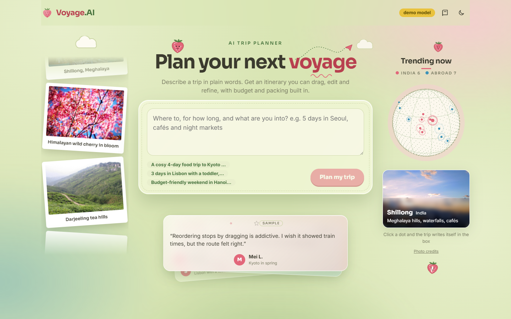
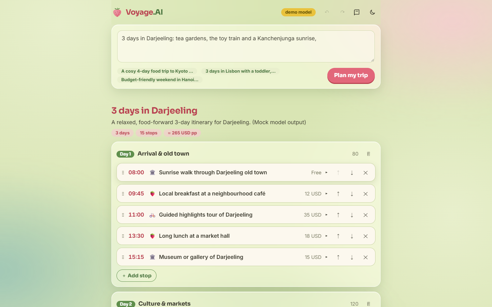
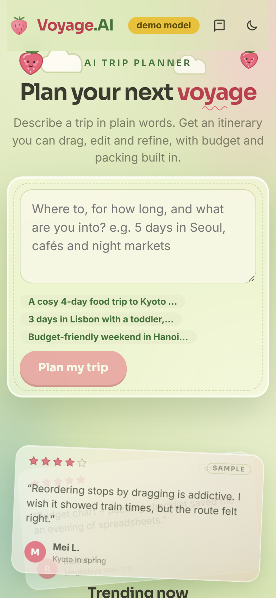
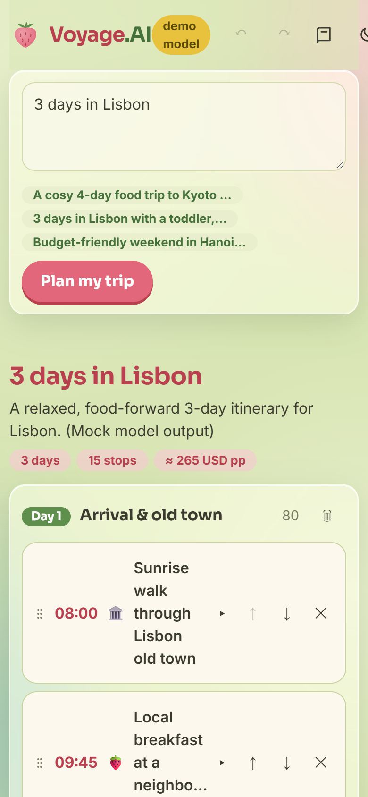

# Voyage.AI: AI trip planner with a 3D globe

Describe a trip in plain English. A real LLM streams back **structured blocks** (trip, days, stops, checklist, budget chart, tips). The app validates every block and renders them as an interactive, stateful itinerary you can expand, edit, drag, remove, undo and refine. The model's text is never shown to the user: this is **not a chatbot**.

**Live demo:** https://tripplanner-q2k7.onrender.com

> ⏳ Hosted on Render's free tier: the service **spins down after ~15 min idle**, so the first request can take 30–60 s to wake.
> The live demo calls Google **Gemini** (`gemini-3.5-flash-lite`) from the server. If no key is configured the app falls back to a built-in **mock model** (a "demo model" badge appears in the header), so it always works.

| Landing (3D globe, drag + click pins) | Generated plan |
|---|---|
|  |  |

| Mobile landing | Mobile plan |
|---|---|
|  |  |

---

## Brief → where it's met

| Requirement | Where |
|---|---|
| React, hooks, functional components | `client/src/**` (no class components) |
| Free-form text input | `PromptForm` in `components/Panels.jsx` |
| Real LLM API | `server/providers/` (Gemini via OpenAI-compatible API, Anthropic, or mock). **Server-side only**; the key never reaches the browser |
| Structured data → interactive stateful UI | NDJSON blocks, validated by a shared zod schema, folded into a reducer, rendered as cards |
| Bad output: malformed JSON, wrong shape, empty, slow, failed | [Failure handling](#failure-handling-the-important-part) |
| No crashes; error or retry | `ErrorPanel` with Retry, one silent auto-retry, partial results kept |
| Stale response must not overwrite a newer one | request id + `AbortController` in `usePlanner` |
| Loading / error / empty states | skeleton, streaming status bar, error panel, landing hero |
| Mobile | single-column layout, touch reorder buttons, tested at 390 px |
| 3D interactive frontend | three.js "Trending now" globe + CSS 3D tilt (see [3D](#3d-and-motion)) |

## Frontend architecture

```
App.jsx ── useReducer(historyReducer)            plan state + undo/redo (pure, unit-tested)
   │    └─ usePlanner(dispatch)                  request lifecycle: reqId, AbortController, retry, stall watchdog
   │
   ├─ Landing (no plan yet)    Globe (lazy, three.js) · Polaroids (CSS 3D tilt) · ReviewCards (auto-swipe) · PromptForm (typewriter)
   └─ Plan view                PromptForm · StatusBar · ErrorPanel · ItineraryView (days/stops, DnD, keyboard)
                               Extras (checklist · budget chart · tip) · RefineBar · SessionsPanel
```

**From unpredictable text to reliable UI**

```
browser ──POST /api/plan──▶ Express ──stream──▶ LLM (Gemini | Anthropic | mock)
   ▲                           │  NDJSON lines → forgiving parser → zod validation
   └── NDJSON events ◀─────────┘  {event: start | block | warn | done | error}
```

- **One JSON block per line** instead of one giant document. Each line is validated as soon as it completes and forwarded immediately, so the UI **streams**, and one bad line costs one block, not the whole answer.
- **Shared schema** (`shared/index.js`, zod) is used by server *and* client; the client re-validates everything it receives.
- **Pure reducer** (`client/src/lib/planReducer.js`) holds the plan plus undo/redo history. Every AI step and every manual edit is one undoable action. Unit-tested.
- **Stale-response guard** (`hooks/usePlanner.js`): every request gets an id and an `AbortController`; only the newest request may touch state. Esc cancels.
- **Optimistic, forgiving rendering**: optional fields default (`.catch`) instead of failing; unknown categories fall back to a generic icon.
- **Sessions**: autosaved to `localStorage`, validated again on load.

### 3D and motion

- **"Trending now" globe** (`components/Globe.jsx`, three.js): 13 destinations, **6 in India** (Shillong, Darjeeling, Jaipur, Goa, Leh-Ladakh, Munnar) and **7 abroad** (Kyoto, Lisbon, Bali, Bangkok, Dubai, Singapore, Santorini), India in berry, abroad in sky blue. Drag to spin (with inertia), hover a dot for its name and a **real photo card**, click a dot: the globe turns and zooms to it, a flight arc is drawn from the previous pick, and the trip **writes itself into the prompt box** (typewriter effect; typing yourself cancels it; reduced motion makes it instant).
- The list lives in `client/src/lib/places.js`. It is **hand-curated**, not live analytics: "Trending" is an editorial label, not measured data.
- **Performance + safety**: lazy-loaded chunk (the page paints before three.js arrives), pauses when off-screen or the tab is hidden, `prefers-reduced-motion` stops auto-rotation, WebGL feature-detected with a fallback, all geometries/materials/renderer disposed on unmount, colours read from the CSS theme tokens (follows dark mode).
- **Keyboard**: the globe is focusable; **←/→** choose a destination (the photo card is an `aria-live` region, so the choice is announced) and Enter re-writes the trip. On phones the globe is accompanied by a tappable photo strip of the same places.
- **Slow photo reel** (left of the prompt): five real photos in a seamless, upward-scrolling loop (the list is rendered twice and translated by −50% in CSS, the copy is `aria-hidden`; it pauses on hover and stops for `prefers-reduced-motion`).
- **CSS 3D tilt** on the polaroids (pointer position → `perspective()` rotation via CSS variables, no re-renders).
- The globe is a dotted sphere + graticule; no continent outlines are bundled.

### Photos and credits

All place photos are real photographs from **Wikimedia Commons** under Creative Commons licences (CC BY, CC BY-SA, or CC0), resized and **self-hosted** in `client/public/img/places/` (the strict CSP forbids hotlinking, and self-hosting means they never break). Every photo's author, licence and source page is listed at [`/credits.html`](client/public/credits.html) (linked from the UI as "Photo credits").
The "Himalayan wild cherry in bloom" polaroid shows *Prunus cerasoides*, the species behind Shillong's November blossom; the photo itself was taken elsewhere, and its caption says only what it shows. The review cards are **sample copy** with mixed ratings (5, 4 and 3 stars); each card carries a small "sample" tag so nobody mistakes them for real customers.

### Design system

- Tokens as CSS variables (`styles.css`): watercolour sage / blush / cream / leaf palette, light + dark theme (follows the OS, toggle persists).
- Typography: **Sora** (display, headings, "Trending now") + **Inter** (body), self-hosted via `@fontsource-variable` so nothing is fetched from a third party and the strict CSP stays intact.
- **Glass finish**: translucent cards with `backdrop-filter` blur + saturation, a 1 px light edge and an inner highlight, over soft blurred colour blobs; separate light and dark tokens. Icons are inline SVG line icons (no emoji), and the doodles are original SVG (cute strawberries, clouds, a paper-plane trail).
- Layout: the landing is vertically centred in the viewport; at ≤1020 px it collapses to one column and the polaroids become a snap-scrolling strip.
- Accessibility: visible focus rings, labelled controls, `role="status"` live region for progress, `role="alert"` for errors. Keyboard shortcuts still work (**Alt+↑/↓** reorders a focused stop, Enter expands, Delete removes, Ctrl+Z undoes, Esc cancels a running request) but are no longer printed on screen.

## Failure handling (the important part)

| Failure | Where handled | Behaviour |
|---|---|---|
| Malformed line / wrong shape | server parser + zod | line dropped, stream continues, "N skipped" shown |
| Bad optional field (`cost:"abc"`, unknown category) | schema `.catch` | field defaulted, stop kept |
| Pretty-printed / fenced / differently-keyed JSON | whole-document fallback | recovered via balanced-brace scan + normaliser |
| Prose, empty reply, zero stops | server | `NO_ITINERARY` error + Retry |
| Upstream 4xx/5xx/429/timeout/unreachable | providers + server | mapped to safe error codes (no upstream bodies or keys leaked), `retryable` flag |
| Stream dies mid-response | client | partial plan **kept**, error + Retry shown |
| Network drop / server stalls >30 s | client watchdog | `STALLED` / `TRUNCATED` / `NETWORK` error |
| Retryable error before any output | client | one silent auto-retry |
| Stale response | `usePlanner` | request id + `AbortController`; only the newest request can touch state |
| Failed with nothing received | reducer | previous plan restored |
| Oversize / invalid request, rate limit, overload | server | 400/413/429/503 JSON errors; per-IP limit + concurrency cap |
| Client disconnects | server | upstream call aborted (no wasted tokens) |

**Try them live** by adding a tag to the prompt (mock model only): `[fail]` `[slow]` `[garbage]` `[empty]` `[partial]` `[pretty]`, e.g. `3 days in Rome [partial]`.

## Proposed integration endpoints (future work)

Real booking systems (IRCTC, MakeMyTrip, Goibibo, Google Pay) are **not** publicly callable from a student project: they need partner agreements, licences or merchant accounts. So the backend ships a **stable contract** under `/api/integrations/*`. Today one capability is live and three are clearly flagged mocks (`"mock": true`); swapping a mock for a real provider means replacing one function body, with no change to the UI contract.

`GET /api/integrations` returns this registry.

> **Weather on the hosted demo:** verified returning real Open-Meteo data when run locally (e.g. Shillong, fog, 20/9 °C), but on Render's free tier Open-Meteo answers the forecast call with **HTTP 429** (its free tier rate-limits shared cloud IPs), so the hosted endpoint currently returns the deterministic mock with `"mock": true`. The server logs the reason. Fixes: Open-Meteo's paid API key, a different keyless provider such as MET Norway, or a short per-city cache.

| Capability | Endpoint | Status now | Real provider path |
|---|---|---|---|
| **Weather** | `GET /api/integrations/weather?city=&start=&days=` | **Live** ([Open-Meteo](https://open-meteo.com), free, no key) with automatic, flagged mock fallback. See the note below | already real |
| **Transport** | `GET /api/integrations/transport/search?from=&to=&date=&mode=train\|flight\|bus&passengers=` | Mock | IRCTC through an authorised partner API · MakeMyTrip B2B / Amadeus for flights · redBus partner API for buses |
| **Stays** | `GET /api/integrations/stays/search?city=&checkin=&nights=&guests=&type=hotel\|homestay\|hostel\|any&maxPriceInr=` | Mock | Booking.com Demand API · Goibibo (MakeMyTrip) partner API · a homestay aggregator (Airbnb has no public booking API) |
| **Payments** | `POST /api/integrations/payments/intent` then `POST /api/integrations/payments/confirm` | Mock (no money moves) | Google Pay API in the browser + a PSP (Razorpay / Stripe) on the server; UPI intent via the PSP |

Example:

```bash
curl "$URL/api/integrations/weather?city=Shillong&days=3"
curl "$URL/api/integrations/transport/search?from=Guwahati&to=Shillong&date=2026-12-02&mode=bus"
curl -X POST "$URL/api/integrations/payments/intent" -H 'content-type: application/json' \
     -d '{"amountInr":2500,"method":"gpay","description":"Shillong stay"}'
```

**How it would plug into the planner**

1. *Weather* → feed the forecast into the prompt so the model reorders outdoor stops around rain, and drive the packing checklist (`packingHints` is already returned).
2. *Transport* → a new `transport` block type between days (add to `shared/`, reducer, renderer, prompt, mock, test; the repo's conventions list exactly these steps).
3. *Stays* → a `stay` block per night with a "swap" action that calls the search endpoint.
4. *Payments* → create an intent for the trip total, run Google Pay's `loadPaymentData()` in the browser, send the token to the PSP-backed confirm step. **Raw card numbers must never touch this server**: the intent schema is `.strict()`, so a card number in the body is rejected (covered by a test).

All integration routes share the per-IP rate limiter, validate every parameter with zod, and return the same `{error:{code,message,retryable}}` shape as the planner.

## Setup

Requires Node 20+.

```bash
npm install
cp .env.example .env     # optional: add a key. With no key you get the mock model
npm run dev              # API on :8787, web on http://localhost:5173
npm test                 # 17 tests: server parser + integrations, client reducer
npm run build && npm start   # production: Express serves client/dist
```

Docker (also what Render can run): `docker compose up --build` → http://localhost:8787

**Real model** (server-side only):

- Gemini (what the live demo uses): `LLM_PROVIDER=openai`, `LLM_BASE_URL=https://generativelanguage.googleapis.com/v1beta/openai`, `LLM_MODEL=gemini-3.5-flash-lite`, `LLM_API_KEY=…`, **`LLM_STREAM=false`**
- Anthropic: `ANTHROPIC_API_KEY`
- Any other OpenAI-compatible API (Groq, OpenRouter, OpenAI, Ollama): `LLM_PROVIDER=openai` + `LLM_BASE_URL` / `LLM_MODEL` / `LLM_API_KEY`

Why `LLM_STREAM=false` for Gemini: during testing, SSE streaming from Gemini 3.x through the OpenAI-compatible endpoint hung with no bytes for 40 s+, while a plain request returned in ~4 s. With that flag the server makes one non-streaming call and feeds the reply through the same line parser, so blocks still reach the UI one by one. A larger Gemini model (`gemini-3.8-flash`) took ~87 s per plan and hit the 90 s upstream timeout, which is why the demo uses the `flash-lite` model.

Deploy on Render: **New → Blueprint** → select the repo (`render.yaml`: Docker, free plan, health check `/healthz`), then add the `LLM_*` variables in the Environment tab. Never commit keys.

## AI-usage note

AI (Claude) wrote most of the boilerplate and helped debug. The **flow and design were mine**: the colour palette and mood, the main user flow, the decision to stream one block per line, the failure-handling plan, the refinement loop and the 3D globe interaction. I then used AI to put the pieces in place, and to debug, review and test them. Deployment and the Gemini/Render configuration were also done with AI assistance. At runtime the app calls an LLM only through `server/providers/*`, server-side.

## Time spent

About **5 hours** in total:

| Activity | Time |
|---|---|
| UI design: colours, main flow map-out | ~1 h |
| AI-assisted coding | ~2 h |
| Debugging and deploying | ~1 h |
| Polishing | ~1 h |

## Known limitations

- Rate limiter and sessions are in-memory / `localStorage`: fine for one instance; use Redis + a DB to scale or sync across devices.
- Times and costs come from the model and are **estimates**; there are no real maps, geocoding or live prices. Transport, stays and payments endpoints are mocks (see above).
- Reordering doesn't recompute times; a refine pass can.
- Refinement re-emits the full plan (simple and robust) rather than patch ops, so it costs more tokens on big plans.
- Native HTML5 drag-and-drop doesn't work on touch screens; the ↑/↓ buttons and the "Move to" menu cover mobile.
- Gemini is called without streaming (see above), so on the live demo a plan appears after a few seconds rather than card by card.
- The free Render tier cold-starts and has no persistent disk.
- The globe has no continent outlines, and the 13 "trending" pins are a curated list, not live data.

## What I'd do next

Wire the weather endpoint into the prompt, add `transport` and `stay` block types, replace the mock stays/transport adapters with a licensed provider, add Playwright end-to-end tests for the failure tags, and move sessions to a small DB so plans sync across devices.

## Layout

```
shared/   zod block schema (single source of truth)
server/   Express API, providers (gemini/openai-compat | anthropic | mock), parser, integrations/, tests
client/   React + Vite UI: reducer with undo history, usePlanner hook, components (incl. 3D Globe), tests
docs/screenshots/   images used above
Dockerfile · docker-compose.yml · render.yaml · CLAUDE.md
```
